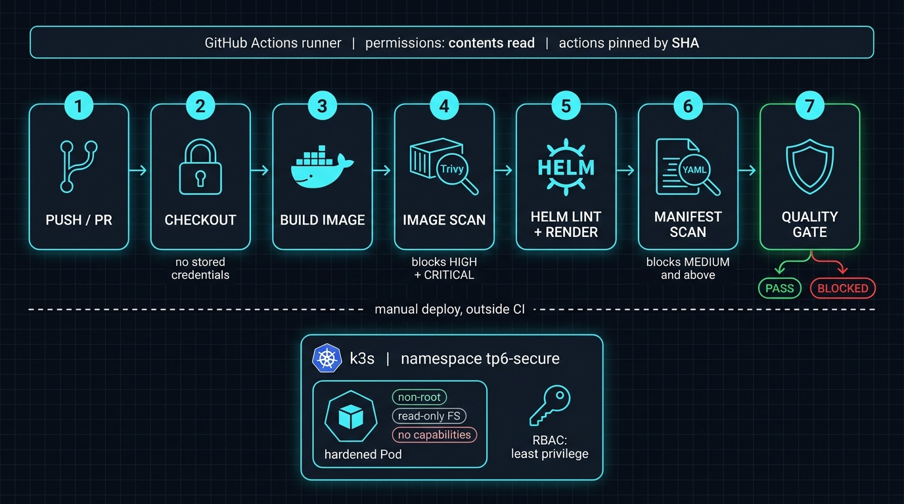
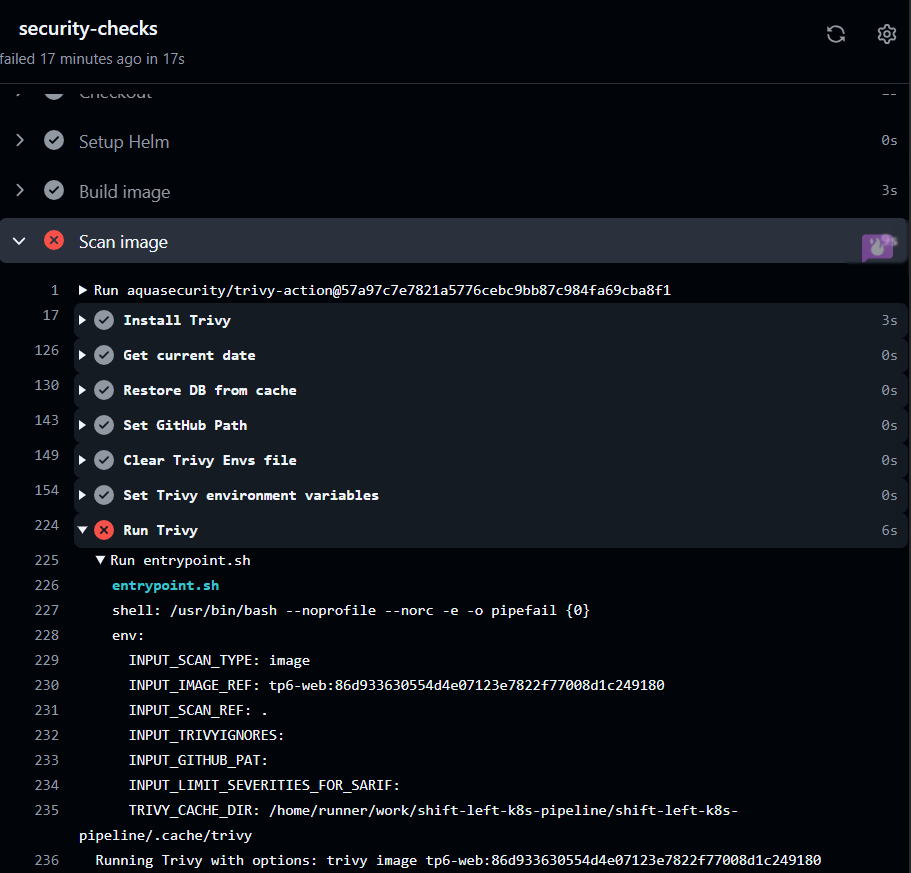
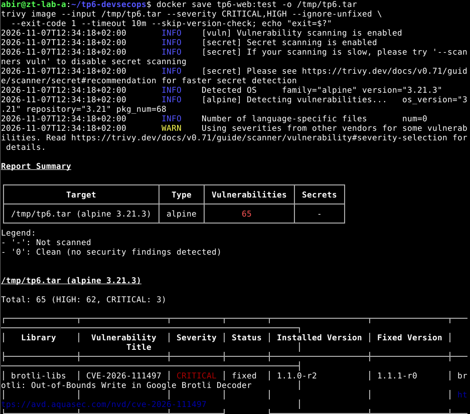
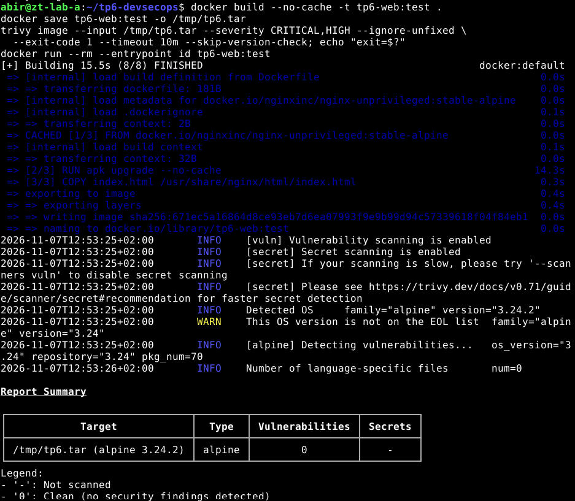
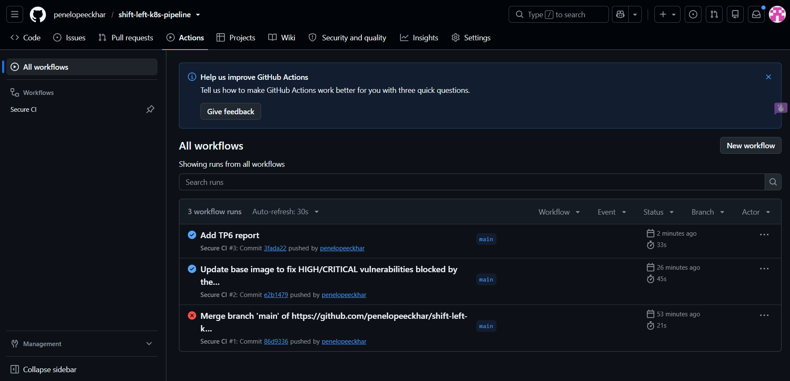
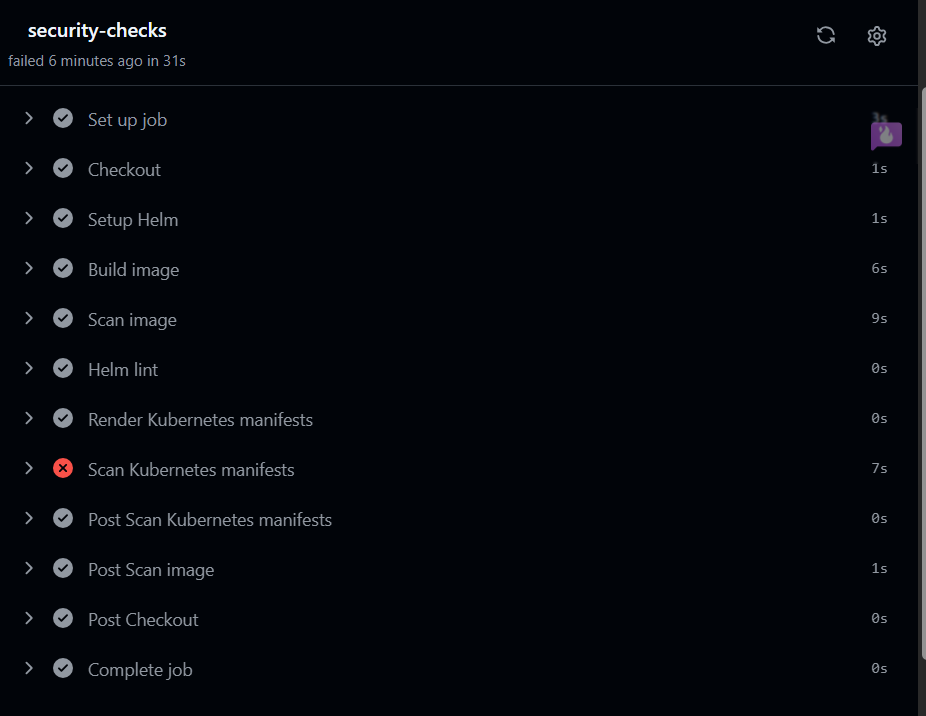
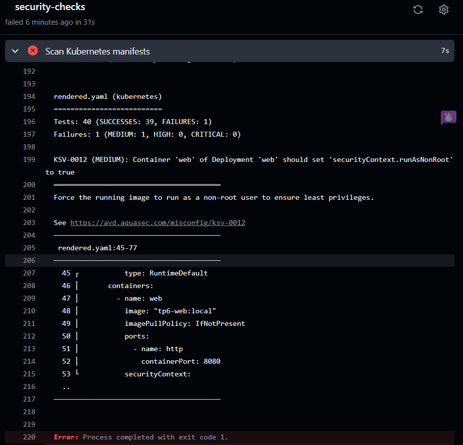
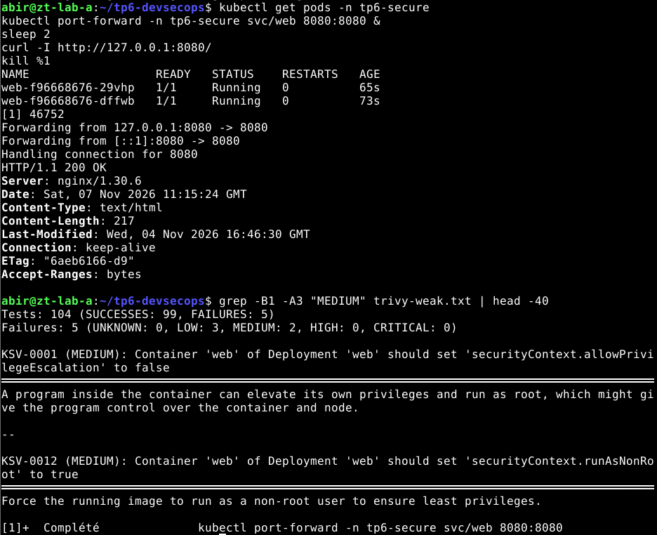
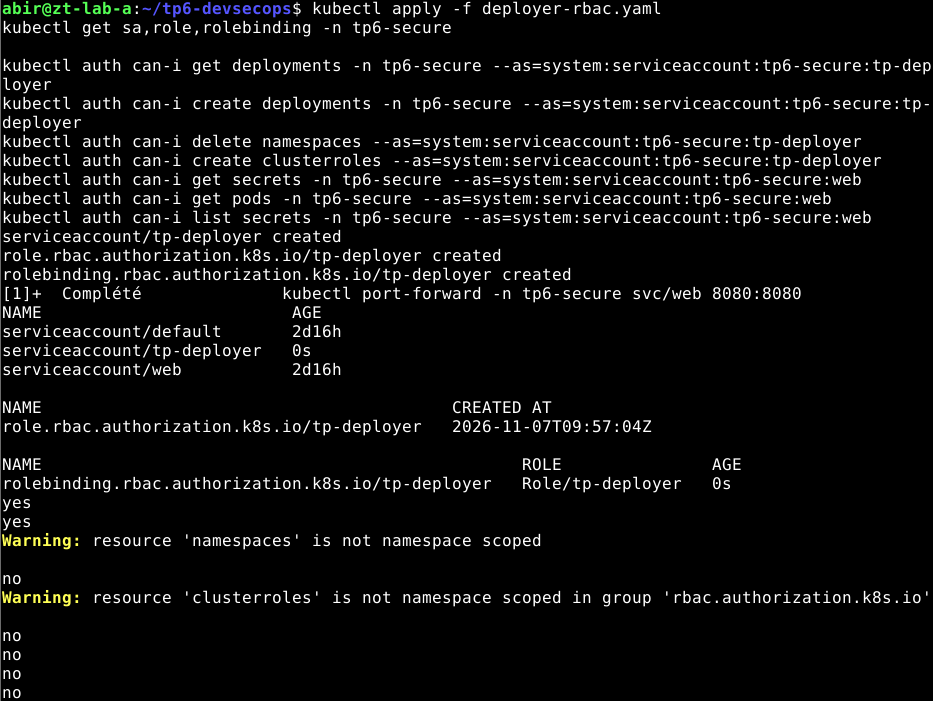

# Shift-Left Kubernetes Pipeline

A secure CI/CD pipeline for a containerized web application on Kubernetes. Security checks run **before** deployment and **block** the pipeline on findings: hardened workflow, scanned image, validated Helm chart, least-privilege RBAC.

Built as a hands-on DevSecOps lab (chapter 6: secure CI/CD chain). Full write-up with commands, results, answers and all screenshots: [REPORT.md](REPORT.md).

## Pipeline

<p align="center"></p>

The workflow validates; the deployment is done separately from the workstation. GitHub Actions never gets access to the cluster.

## What it demonstrates

| Area | Implementation |
|---|---|
| Workflow hardening | `contents: read` only, `persist-credentials: false`, job timeout, third-party actions pinned by full commit SHA |
| Image security | Trivy image scan with explicit severity threshold, `exit-code: 1` |
| Manifest security | Trivy config scan on the **rendered** Helm output, threshold extended to MEDIUM |
| Pod hardening | Non-root (UID 101), no privilege escalation, all capabilities dropped, read-only root filesystem, seccomp `RuntimeDefault`, resource requests and limits, no service account token mounted |
| Identities | Application ServiceAccount (no rights) separate from a namespace-scoped deployer Role, verified with `kubectl auth can-i` |

## Results

### The quality gate caught a real problem

The first run failed on the base image `nginx-unprivileged:1.27-alpine` (Alpine 3.21.3): 65 HIGH/CRITICAL vulnerabilities with an available fix (openssl, curl, libexpat, libpng, musl, zlib, ...).

| Step | Image | HIGH/CRITICAL (fixable) |
|---|---|---|
| Initial | `1.27-alpine` (Alpine 3.21.3) | 65 (62 HIGH, 3 CRITICAL) |
| Newer base | `stable-alpine` (Alpine 3.24.2) | 10 (9 HIGH, 1 CRITICAL) |
| `apk upgrade` added | same | **0** |

<p>
  
  
</p>
<p>
  
  
</p>

### The gate also blocks insecure configuration

A test pull request that only sets `runAsNonRoot: false` fails at the manifest scan with `KSV-0012` (MEDIUM). Without the MEDIUM threshold it would have passed.

<p>
  
  
</p>

### Deployment and RBAC

Two Pods running the hardened image answer `HTTP/1.1 200 OK`. RBAC checks use impersonation (`kubectl auth can-i --as=...`): the deployer can manage Deployments in its namespace and nothing cluster-wide; the application account can do nothing.

<p>
  
  
</p>

## Repository layout

```
.github/workflows/secure-ci.yml   CI workflow
charts/web/                       Helm chart (Deployment, Service, ServiceAccount)
Dockerfile                        Non-root nginx image, packages upgraded
deployer-rbac.yaml                Namespace-scoped deployer identity
index.html                        Static application
REPORT.md                         Lab report
docs/screenshots/                 Evidence (terminal and GitHub captures)
```

## Run it locally

```bash
docker build -t tp6-web:local .
trivy image --severity CRITICAL,HIGH --ignore-unfixed --exit-code 1 tp6-web:local

helm lint ./charts/web
helm template web ./charts/web > rendered.yaml
trivy config --severity CRITICAL,HIGH,MEDIUM --exit-code 1 rendered.yaml

# k3s: import the image into containerd (kind: kind load docker-image)
docker save tp6-web:local | sudo k3s ctr images import -
kubectl create namespace tp6-secure
helm upgrade --install web ./charts/web -n tp6-secure --wait --timeout 120s
```

## Limitations

- Image tags (`stable-alpine`, `local`) are mutable. Production should reference the base image by digest, with signature and provenance verification.
- `apk upgrade` keeps the image patched but makes builds less reproducible.
- CI and local builds use the same Dockerfile with different tags: this validates the build recipe, not binary identity.
- `kubectl auth can-i --as` checks authorization only, not authentication.
- Trivy detects misconfigurations after the fact; blocking them at admission needs an admission controller (Pod Security Admission, Kyverno, Gatekeeper).
- The deployer Role covers the lab chart only. It grants access to Secrets (Helm release storage), a sensitive permission, and does not include ServiceAccounts, which the chart creates: Helm ran with the workstation's kubeconfig in this lab.

## Stack

GitHub Actions, Docker, Trivy, Helm 3, Kubernetes (k3s), RBAC.
